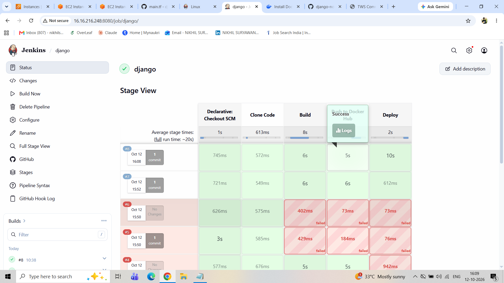
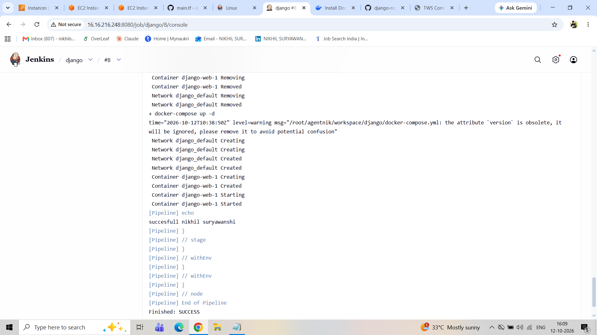
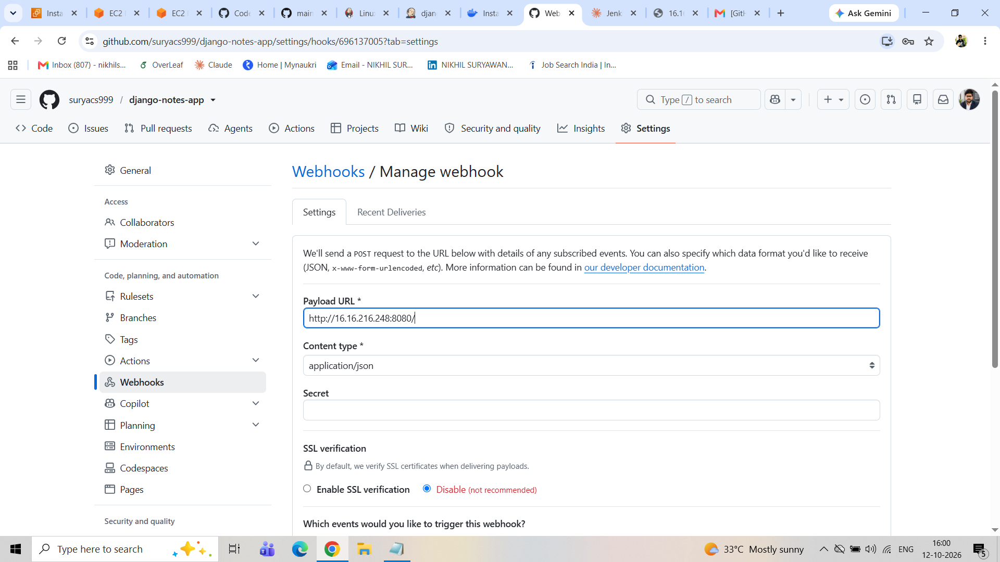
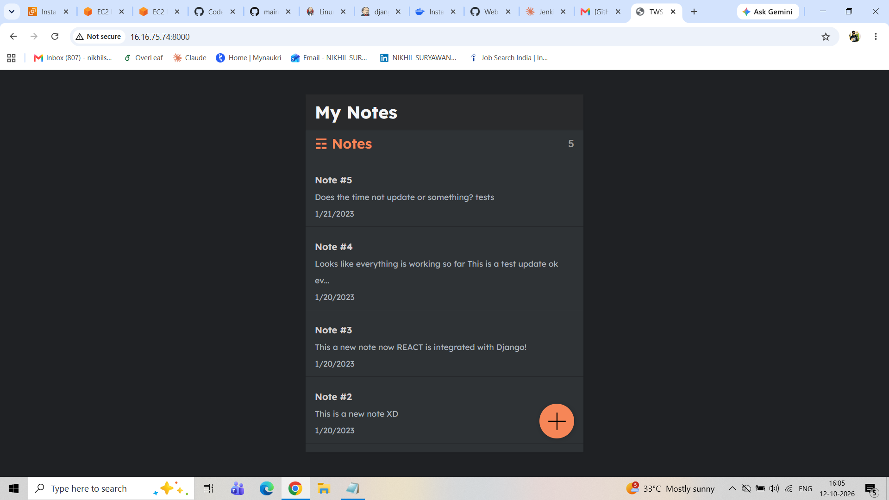

# Django Notes App – CI/CD Pipeline with Jenkins, Docker & Docker Compose

**Author:** Nikhil Suryawanshi
**Role:** Associate DevOps Engineer

A simple notes application (Django REST API + React frontend) that I containerized and automated with a complete CI/CD pipeline. Every push to GitHub triggers Jenkins, which builds the Docker image, pushes it to Docker Hub, and deploys the container on an AWS EC2 instance.

> The application code is based on the open-source [django-notes-app](https://github.com/LondheShubham153/django-notes-app). My work in this repository is the DevOps side: the Dockerfile, the Jenkins pipeline, the GitHub webhook automation, and the deployment setup.

---

## Table of Contents

- [Architecture](#architecture)
- [Tech Stack](#tech-stack)
- [Project Structure](#project-structure)
- [Prerequisites](#prerequisites)
- [Run Locally](#run-locally)
- [CI/CD Pipeline](#cicd-pipeline)
- [Jenkins Setup](#jenkins-setup)
- [GitHub Webhook Setup](#github-webhook-setup)
- [API Endpoints](#api-endpoints)
- [Screenshots](#screenshots)
- [Issues I Faced and How I Fixed Them](#issues-i-faced-and-how-i-fixed-them)
- [Author](#author)

---

## Architecture

```
Developer ──push──► GitHub ──webhook──► Jenkins (EC2)
                                           │
                                           ├─ 1. Clone code
                                           ├─ 2. Build Docker image
                                           ├─ 3. Push image to Docker Hub
                                           └─ 4. Deploy with Docker Compose
                                                        │
                                                        ▼
                                              Notes App running on :8000
```

*(You can replace this with an architecture diagram image: ``)*

## Tech Stack

| Area | Tools |
|------|-------|
| Backend | Python 3.9, Django 4.1, Django REST Framework |
| Frontend | React 18 |
| Containerization | Docker, Docker Compose |
| CI/CD | Jenkins (Declarative Pipeline), GitHub Webhooks |
| Registry | Docker Hub |
| Cloud | AWS EC2 |

## Project Structure

```
django-notes-app/
├── api/                  # Django REST API (models, views, urls)
├── notesapp/             # Django project settings
├── mynotes/              # React frontend
├── Dockerfile            # Image definition for the Django app
├── docker-compose.yml    # Runs the app from the Docker Hub image
├── Jenkinsfile           # CI/CD pipeline definition
├── requirements.txt      # Python dependencies
└── README.md
```

## Prerequisites

- An AWS EC2 instance with Jenkins installed
- A Jenkins agent node (label: `nikhil`) with Docker and Docker Compose installed
- Docker Hub account
- Jenkins credentials:
  - `dockercred` – Docker Hub username and password (Username with password)
- Security group allowing inbound TCP **8080** (Jenkins) and **8000** (app)

## Run Locally

**1. Clone the repository**

```bash
git clone https://github.com/suryacs999/django-notes-app.git
cd django-notes-app
```

**2. Build the image**

```bash
docker build -t notes-app:latest .
```

**3. Run the container**

```bash
docker run -d -p 8000:8000 notes-app:latest
```

**4. Open the app**

```
http://localhost:8000/api/notes/
```

Or with Docker Compose (pulls the image from Docker Hub):

```bash
docker-compose up -d
```

## CI/CD Pipeline

The pipeline is defined in the [`Jenkinsfile`](Jenkinsfile) and has four stages:

| Stage | What it does |
|-------|--------------|
| **Clone Code** | Pulls the `main` branch from GitHub |
| **Build** | Builds the Docker image `notes-app:latest` |
| **Push to Docker Hub** | Logs in securely with `--password-stdin`, tags and pushes the image |
| **Deploy** | Runs `docker-compose down && docker-compose up -d` to redeploy the latest image |

Docker Hub credentials are stored in Jenkins Credentials and are never hard-coded in the pipeline.

## Jenkins Setup

1. Install the **GitHub** and **Pipeline** plugins.
2. Add the agent node with label `nikhil` (Manage Jenkins → Nodes).
3. Add Docker Hub credentials with ID `dockercred` (Manage Jenkins → Credentials).
4. Create a **Pipeline** job named `django`:
   - Definition: *Pipeline script from SCM*
   - SCM: Git → `https://github.com/suryacs999/django-notes-app.git`
   - Branch: `main`
   - Script Path: `Jenkinsfile`
5. Under Build Triggers, enable **GitHub hook trigger for GITScm polling**.

## GitHub Webhook Setup

In the GitHub repository go to **Settings → Webhooks → Add webhook**:

| Field | Value |
|-------|-------|
| Payload URL | `http://<EC2-PUBLIC-IP>:8080/github-webhook/` |
| Content type | `application/json` |
| Events | Just the push event |

Now every `git push` to `main` starts a Jenkins build automatically.

## API Endpoints

| Method | Endpoint | Description |
|--------|----------|-------------|
| GET | `/api/` | List all routes |
| GET | `/api/notes/` | Get all notes |
| GET | `/api/notes/<id>/` | Get a single note |
| POST | `/api/notes/create/` | Create a note |
| PUT | `/api/notes/<id>/update/` | Update a note |
| DELETE | `/api/notes/<id>/delete/` | Delete a note |

## Screenshots

> Create a folder named `screenshots` in the repository root, save your images there, and keep the file names below (or edit the paths).

### 1. Jenkins Pipeline – Successful Build


### 2. Jenkins Console Output


### 3. Docker Hub Repository


### 4. GitHub Webhook (Recent Deliveries – 200 OK)


### 5. Running Containers on EC2


### 6. Application Running in Browser


## Issues I Faced and How I Fixed Them

| Problem | Cause | Fix |
|---------|-------|-----|
| `docker-compose: not found` (exit code 127) | Docker Compose was not installed on the Jenkins agent | Installed Docker Compose on the agent node |
| `pull access denied ... repository does not exist` | Image name in `docker-compose.yml` did not match the pushed image | Used the same name (`notes-app`) in the Jenkinsfile and the compose file |
| `invalid reference format` | `IMAGE_NAME` already contained `:latest`, so the tag was `notes-app:latest:latest` | Set `IMAGE_NAME = 'notes-app'` (name only) |
| GitHub webhook failing | Payload URL pointed to the Jenkins home page | Changed it to `http://<IP>:8080/github-webhook/` |

## Author

**Nikhil Suryawanshi** – Associate DevOps Engineer

- Email: niksuryawanshi9999@outlook.com
- GitHub: [github.com/suryacs999](https://github.com/suryacs999)
- LinkedIn: [linkedin.com/in/niksuryawanshi9999](https://linkedin.com/in/niksuryawanshi9999)

If you found this project useful, give it a ⭐ on GitHub.
